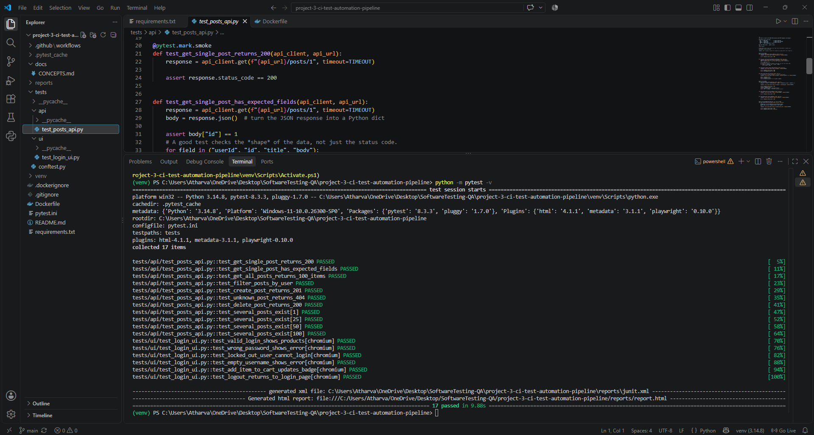
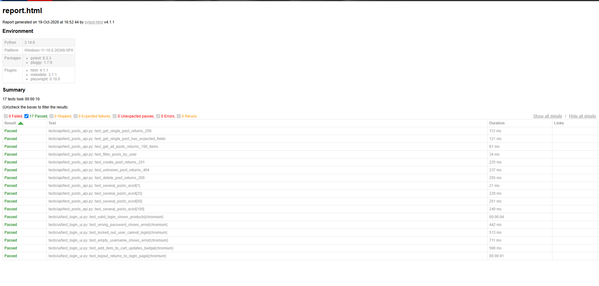
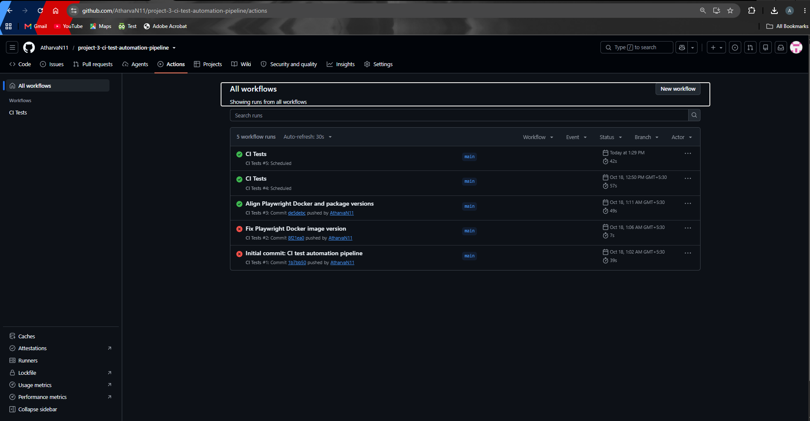

# CI/CD Test Automation Pipeline


This project automates API and browser UI tests using Python, pytest, Playwright, Docker, and GitHub Actions. The pipeline builds a Docker image, runs the test suite, and saves test reports as downloadable artifacts.

## Test Results

**Latest local run:** 17 passed, 0 failed in 9.88 seconds.

| Test group | Passed |
|---|---:|
| API tests | 11 |
| UI tests (Chromium) | 6 |
| **Total** | **17** |

The GitHub Actions page also shows successful workflow runs after the Playwright and Docker version mismatch was fixed.

## How It Works

```text
Code push / Pull request / Scheduled run
                  |
                  v
          GitHub Actions
                  |
                  v
          Build Docker image
                  |
                  v
        Run tests inside Docker
           /             \
          v               v
      API tests         UI tests
      requests      Playwright + Chromium
           \             /
                  v
           Generate reports
          report.html + junit.xml
                  |
                  v
       Upload reports as artifacts
```

## Tech Stack

| Tool | Purpose |
|---|---|
| Python and pytest | Write and run automated tests |
| requests | Send HTTP requests for API testing |
| Playwright | Automate browser-based UI tests |
| pytest-html | Generate an HTML test report |
| Docker | Run tests in a consistent environment |
| GitHub Actions | Run the pipeline automatically |

## What Is Tested?

### API Testing — JSONPlaceholder

Tests against [JSONPlaceholder](https://jsonplaceholder.typicode.com) cover:

- HTTP status codes and response fields
- Retrieving multiple posts
- Filtering posts by user
- Creating and deleting posts
- Handling unknown post IDs
- Parameterized checks for multiple post IDs

### UI Testing — SauceDemo

Tests against [SauceDemo](https://www.saucedemo.com) cover:

- Successful login
- Invalid password and locked-out user
- Empty username validation
- Adding a product to the cart
- Logging out successfully

## Screenshots

### Local test results



### HTML test report



### GitHub Actions workflow



## Project Structure

```text
.
├── .github/
│   └── workflows/
│       └── ci.yml
├── tests/
│   ├── api/
│   │   └── test_posts_api.py
│   └── ui/
│       └── test_login_ui.py
├── screenshots/
│   ├── pytest-results.png
│   ├── html-report.png
│   └── github-actions.png
├── reports/
│   ├── report.html
│   └── junit.xml
├── Dockerfile
├── requirements.txt
├── pytest.ini
├── conftest.py
└── docs/
    └── CONCEPTS.md
```

## Run Locally

### Option 1: Run with Docker

Build the image:

```bash
docker build -t test-suite .
```

Create the reports directory if needed:

```bash
mkdir reports
```

Run the tests and save the reports to your local folder.

**Windows PowerShell:**

```powershell
docker run --rm -v "${PWD}/reports:/app/reports" test-suite
```

To run only API tests:

```powershell
docker run --rm -v "${PWD}/reports:/app/reports" test-suite -m api
```

Open `reports/report.html` in your browser to view the HTML report.

### Option 2: Run without Docker

Create and activate a virtual environment.

**Windows PowerShell:**

```powershell
python -m venv venv
.\venv\Scripts\Activate.ps1
pip install -r requirements.txt
playwright install chromium
```

Run the complete test suite:

```powershell
python -m pytest -v
```

Run specific test groups:

```powershell
python -m pytest -m api
python -m pytest -m ui
python -m pytest -m smoke
```

The marker commands require the corresponding markers to be configured in `pytest.ini` and applied to the tests.

## GitHub Actions Pipeline

The workflow is defined in [`.github/workflows/ci.yml`](.github/workflows/ci.yml).

It is configured to run on code pushes, pull requests, scheduled runs, and manual execution, as defined in the workflow file.

The pipeline builds the Docker image, runs the tests inside a container, and uploads the reports as artifacts.

To view the results:

1. Open this repository's **Actions** tab.
2. Select a workflow run.
3. Review the job logs.
4. Download the `test-reports` artifact if it is available.

The status badge at the top links to the workflow and reflects its latest status.

## Study Guide

The [`docs/CONCEPTS.md`](docs/CONCEPTS.md) file explains the main concepts, project files, and testing workflow in simple terms. It is useful for understanding the implementation and preparing for technical interviews.

## What I Learned

- Writing and organizing API and UI automation tests
- Running Playwright tests with Chromium
- Building a Docker image for automated testing
- Configuring a GitHub Actions CI pipeline
- Generating and reviewing automated test reports
- Troubleshooting a Docker and Playwright version mismatch
